# About this tutorial

This tutorial takes you through a complete, typical surveying job in survey3d, one step at a time. You do not need to have used survey3d before, but it assumes you know basic surveying ideas: coordinates, bearings, levels and field codes.

You will work on a fictional job: **Lot 12, Banksia Street**, a residential lot in Perth, Western Australia. A field crew has already been out. They tied into three control marks, found the four boundary pegs, and picked up a coded detail survey: kerb, road edge, house, fences, trees, a sewer manhole, a bank across the back of the lot, and natural-surface spot heights. The client wants:

1. the lot boundary checked against the plan;
2. a detail survey plan, with contours;
3. how much earth it would take to level the lot to RL 25.30;
4. a garden shed set out in the back yard.

Along the way you will learn the parts of survey3d you will use on almost every job:

| Chapter | You will learn to |
|--|------------|
| 2 | find your way around the window |
| 3 | set up a project: conventions and coordinate system |
| 4 | set up feature codes |
| 5 | import points from a CSV file |
| 6 | turn coded points into linework |
| 7 | enter a lot from plan bearings and distances, and check its closure |
| 8 | compare computed and found corners with an inverse |
| 9 | build a surface with breaklines and contours |
| 10 | calculate cut and fill volumes |
| 11 | prepare a set-out and export a stake-out file |
| 12 | make a plan sheet and print it to PDF |
| 13 | save, undo, and review the audit trail |

Allow about an hour and a half.

## The tutorial files

Everything you need is in the `tutorial/data` folder that comes with this tutorial:

| File | What it is |
|---|-------|
| `control.csv` | Three control marks: name, easting, northing, height, code, description |
| `detail.csv` | The coded detail survey (81 points), in the order they were picked up |
| `lot12_plan.txt` | The lot's bearings and distances from the deposited plan |
| `shed_design.csv` | The four corners of the proposed shed |

Coordinates are MGA2020 zone 50 and heights are AHD.

## How to read the instructions

- **Menu → Item** means click the menu, then the item. For example **File → Import points (CSV/TXT)**.
- `Text in this style` is something you type on the **command line** at the bottom of the window, followed by **Enter**.
- Almost everything can be done either way. You can click through the menus, or type a short command, which many surveyors find faster once they know it. Each step shows both.
- **Esc** cancels whatever you are doing. **Ctrl+Z** (**⌘Z** on a Mac) undoes the last change.

> **About the screenshots.** They were taken by driving survey3d automatically through its agent link (an AI assistant can work in the window as you watch). Where the command line shows a line starting `agent ›`, that step was done that way rather than typed. You will see your own commands there instead.

> **Tip — you cannot break anything.** Every change in survey3d can be undone, and nothing is written to disk until you save. Experiment freely.

# A tour of the window

Start survey3d. You will see an empty, untitled project.

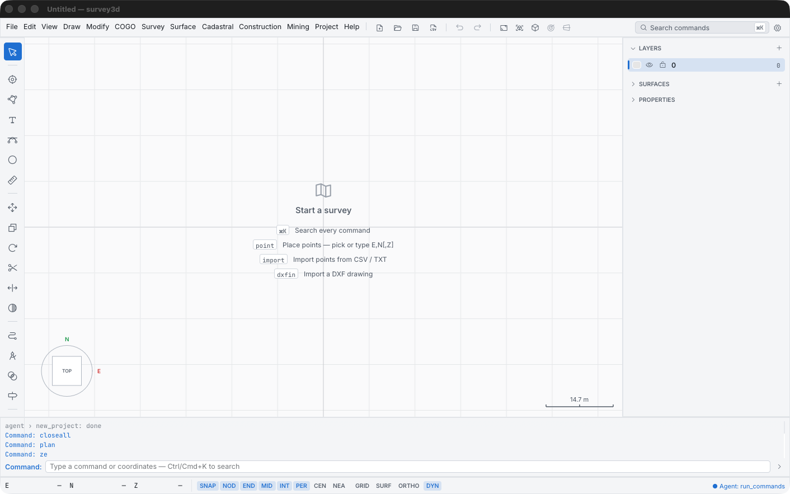

The window has seven parts:

1. **Menu bar** (top). The menus follow the order of a job: **File**, **Edit**, **View**, **Draw**, **Modify**, **COGO**, **Survey**, **Surface**, then a menu for each module (**Cadastral**, **Construction**, **Mining**), **Project** and **Help**.
2. **Toolbar** (beside the menus). New, open, save, undo and redo, and buttons for the common views.
3. **Search commands** (top right, or **Ctrl+K** / **⌘K**). Type a few letters of anything, such as *volume* or *contour*, to find it. This is the quickest way to find a feature you can't place.
4. **Tool palette** (left edge). The drawing and COGO tools you use most. Hover over a button to see its name.
5. **Drawing view** (centre). Your survey, in plan or in 3D. The view cube at the bottom left shows which way you are looking, and the scale bar at the bottom right always shows a round distance.
6. **Side panel** (right). **Layers**, **Surfaces** and **Properties** of whatever is selected.
7. **Command line** and **status bar** (bottom). The command line is where you type commands and coordinates, and where survey3d reports results. The status bar shows the cursor's coordinates and the snap settings (**SNAP**, **END**, **MID** and so on: click one to turn it on or off).

**Moving around the drawing:**

| To | Do this |
|--|------|
| Zoom | Scroll the mouse wheel (it zooms about the cursor) |
| Pan | Drag with the middle mouse button (in plan view, the right button too) |
| Orbit (3D) | Drag with the right mouse button |
| See everything | **Home** key, or **View → Zoom extents**, or type `ze` |
| Plan / 3D | **View → Plan view** (`plan`) or **View → Isometric view** (`iso`) |

> **Tip.** Type `help` on the command line to list every tool and command.

# Setting up the project

Before you bring in any data, tell survey3d how this job measures and where it is.

## Conventions

Conventions control how angles, bearings, distances and coordinates are shown and typed.

1. Choose **Project → Conventions** (or type `conventions`).
2. Set **Preset** to **Australian**. This gives whole-circle bearings in degrees, minutes and seconds, metres to three decimals, coordinates in the order *Easting, Northing*, and heights labelled **RL**.
3. Click **Apply to project**.

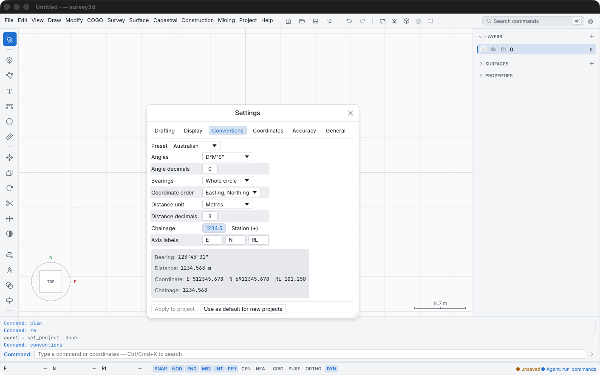

> **Typing bearings.** With these conventions you type a bearing as *degrees.minutesseconds*: 359°47'30" is typed `359.4730`, and 89°46'50" is `89.4650`.

## Coordinate system

1. Open the **Coordinates** tab of the same Settings window.
2. Choose **Projected grid**, then set **Projection** to **UTM zone (GRS80: MGA, ETRS89, NAD83…)**.
3. Set **Zone** to `50` and tick **Southern hemisphere**. The central meridian (117°) and the other projection values follow.
4. Set **Name** to `MGA2020 zone 50` and **EPSG code** to `7850`.
5. Click **Apply to project** and close the Settings window.

## Project name

With nothing selected, the **Properties** panel on the right shows the project. Set its **Name** to `Lot 12 Banksia Street`. It also confirms the coordinate system and conventions you just chose.

The coordinate system is printed on plan sheets and written into exports. It also lets survey3d convert between grid and geographic coordinates and work out grid-to-ground scale factors.

# Feature codes

Field crews code each point as they pick it up: `KB` for kerb, `FNC` for fence, and so on. The **feature code library** tells survey3d what each code means: which layer the points go on, what symbol to draw, and whether points with that code join up into lines.

1. Choose **COGO → Feature codes** (or type `codes`).
2. Click **Add examples**. This adds a small, generic library: control points (`CP`), buildings (`BLD`), fences (`FNC`), kerbs (`KB`), edge of pavement (`EP`), top and bottom of bank (`TB`, `BB`), trees (`TR`), manholes (`MH*`) and natural surface (`NS`).
3. Our crew also used `PEG` for boundary pegs, so add it. Click **+ Add code** and fill in the new row:
    - **Code**: `PEG`
    - **Description**: `Boundary peg`
    - **Layer**: `BOUNDARY MARKS`
    - pick an orange **Colour**, and the **boundary mark** symbol;
    - leave **Lines** unticked. Pegs are single points, not lines.
4. Click **Apply changes**.

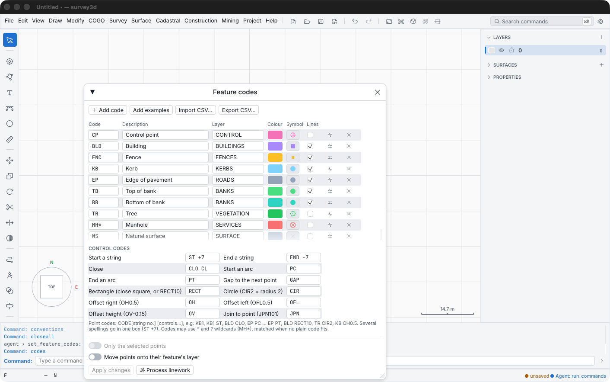

The **Lines** column decides which codes are strung into lines. The **Control codes** below the table are extra words a crew can add after a code to shape the lines:

| Control code | Meaning | Example in our data |
|--|-----|----|
| `ST` | start a new line here | `KB ST` on the first kerb shot |
| `END` | end the line here | `FNC END` on the last fence shot |
| `RECT` | close a rectangle square from three corners | `BLD RECT` on the house's third corner |
| `CLO` | close the line back to its start | |
| `PC` / `PT` | the shots between them form an arc | |

> **Your own codes.** Most firms already have a code list. Use **Import CSV…** to load it, and **Export CSV…** to share it. The library is saved with the project.

# Importing the survey

## The control marks

1. Choose **File → Import points (CSV/TXT)** (or type `import`) and open `tutorial/data/control.csv`.
2. The **Import points** window shows a preview of the file. Check the columns:
    - **Header row**: *Auto* recognises the first line as headings.
    - **Columns**: choose the **PENZC** preset, then click **Add column** and choose **Description**. The columns now read *Point name, Easting, Northing, Z (height), Code, Description*, matching the file.
    - **Layer**: leave it on *Code's layer*, so each point goes on the layer its feature code names.
3. Click **Import**.

## The detail survey

Do the same for `tutorial/data/detail.csv`, with the same **PENZCD** columns.

When both files are in, press **Home** (or type `ze`) to zoom to everything.

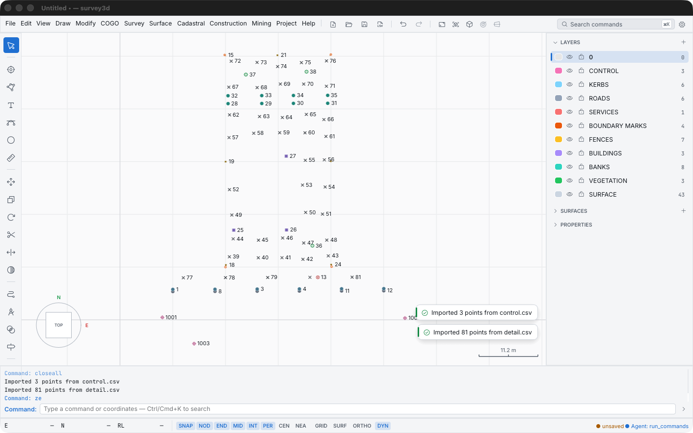

Look at the **Layers** panel on the right. survey3d has created a layer for each feature (**CONTROL**, **KERBS**, **FENCES**, **BUILDINGS** and so on) and put each point on its code's layer. Each layer has buttons to hide it (the eye) and lock it (the padlock), and the number on the right counts its objects.

## Checking the points

Choose **View → Points table** (or type `points`) to see every point as a table. You can sort by any column, filter by name, code or description, and double-click a cell to correct it.

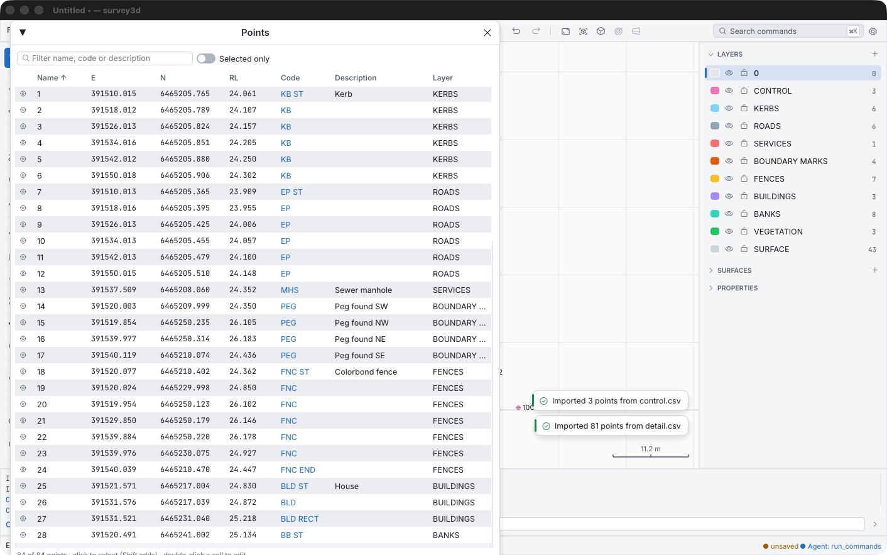

Notice the codes: the first kerb shot is `KB ST`, the house's third corner is `BLD RECT`, and the last fence shot is `FNC END`. The next chapter uses these control codes.

# Linework from field codes

So far the detail is just points. survey3d can draw the lines between them from their codes. This is often called *field-to-finish*.

1. Make sure nothing is selected (press **Esc**). With nothing selected, linework processes every point on the visible, unlocked layers. To process only some points, select them first.
2. Choose **COGO → Process field-to-finish linework** (or type `linework`).

survey3d reports **Linework: 6 strings**: the kerb, the edge of pavement, the fence, the house, and the top and bottom of the bank.

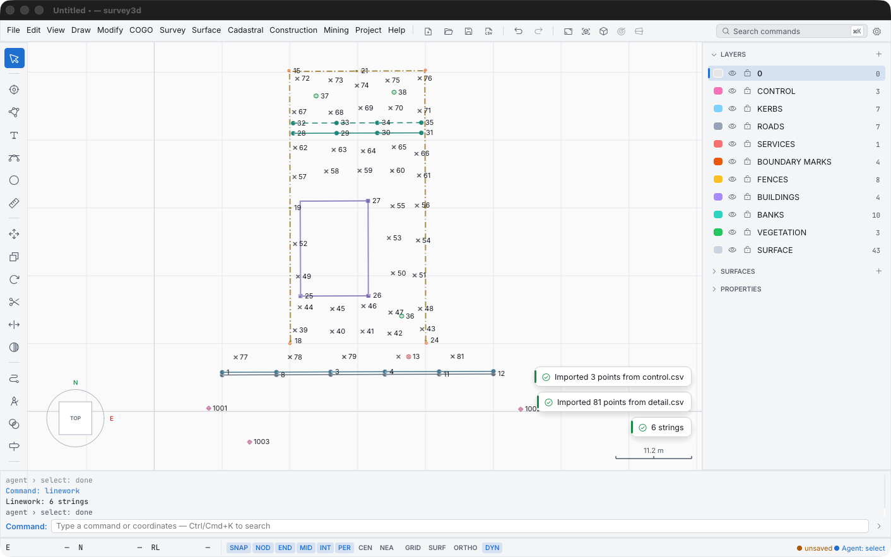

Things to notice:

- The **house** has four sides, though only three corners were shot. `BLD RECT` closed it square.
- The **fence** runs down the west side, across the back and up the east side, then stops, because the last shot was `FNC END`.
- Each line takes the colour, line style and layer from its feature code. Fences are dash-dot, and the top of bank is dashed.

If a crew miscodes a point, fix the code in the Points table and run `linework` again. survey3d replaces the lines it drew before rather than doubling them up.

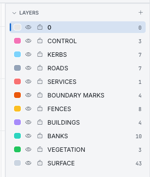{width=40%}

# Entering the lot from the plan

The deposited plan gives the lot's boundary as bearings and distances. Entering them lets you check the plan closes, and compare the plan corners with the pegs the crew found.

From `lot12_plan.txt`:

| Leg | Bearing | Distance | Type it as |
|--|--|--|---|
| SW → NW | 359°47'30" | 40.235 | `359.4730 40.235` |
| NW → NE | 89°46'50" | 20.125 | `89.4650 20.125` |
| NE → SE | 179°48'30" | 40.240 | `179.4830 40.240` |
| SE → SW | 269°47'30" | 20.115 | `269.4730 20.115` |

## A layer for the boundary

Keep the boundary separate from the detail. In the **Layers** panel, click **+** (New layer), name it `BOUNDARY` and give it a red colour. A new layer becomes the **current** layer, the one new objects go on. It is highlighted in the panel.

## Bearing and distance entry

The south-west peg found in the field is point **14** (its description says *Peg found SW*). Start from it:

1. Choose **COGO → Bearing & distance** (or type `bd`).
2. At *start point*, type `14`.
3. Type each leg as *bearing distance*:
    - `359.4730 40.235`
    - `89.4650 20.125`
    - `179.4830 40.240`
    - `269.4730 20.115`

    Each leg creates a new point (1004, 1005…) and moves on to it. The command line shows the coordinates of each one, and how far you are from the start.
4. Type `c` to close. survey3d reports the **misclosure**:

    ```
    Closed 4 legs: misclose 0.002 brg 237°04'48" (1:59546)
                   perimeter 120.715  area 809.544 m² (0.0810 ha)
    ```

    The plan closes to 2 mm, a precision of 1 in 59 546. That is well inside normal limits (**Project → Accuracy limits** sets the limits survey3d checks against).
5. survey3d then asks for a *lot name to make it a parcel*. Type `Lot 12`.
6. Press **Enter** to finish.

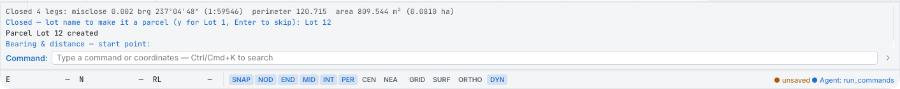

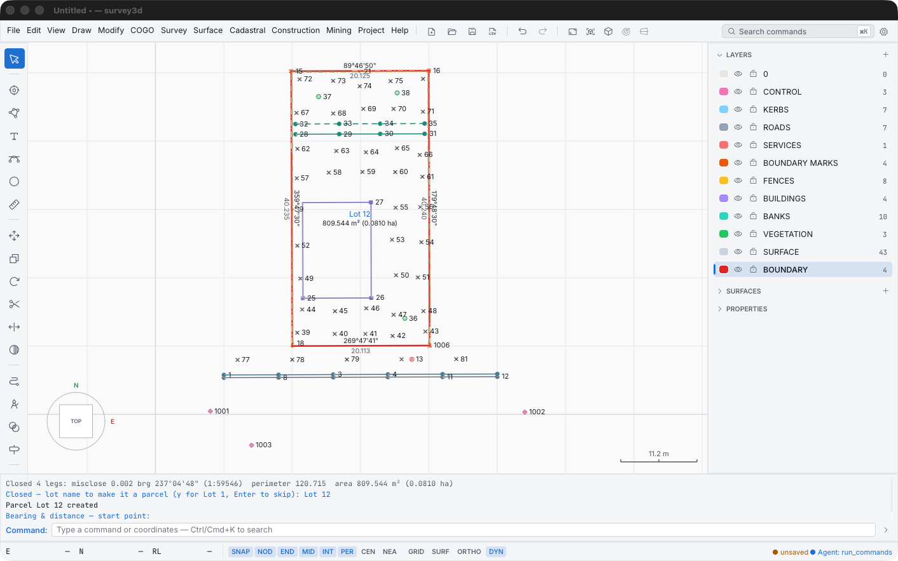

The red boundary is labelled with each leg's bearing and distance, and the lot shows its name and area.

> **`c` or `j`?** `c` treats your last leg as returning to the start and *reports* the misclosure, without adjusting anything. `j` instead *computes* the closing leg from the last point back to the start. Use `j` when the plan's last dimension is missing or is what you are solving for.

## The parcel

Choose **Cadastral → Parcels** (or type `parcels`) to see the lot as a parcel: its area, perimeter and plan closure. Parcels can be labelled on plan sheets, subdivided (**COGO → Subdivide area**) and exported as LandXML for lodgement.

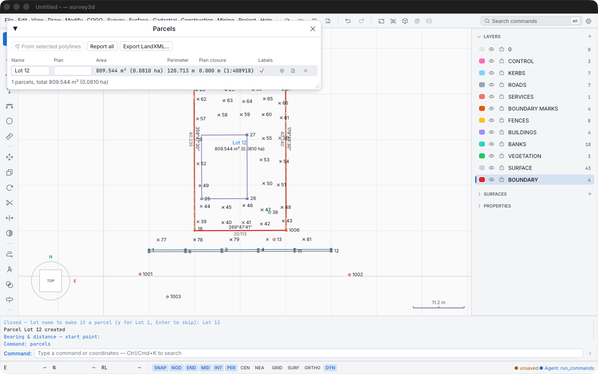

# Checking corners: the inverse

How well do the found pegs agree with the plan? An **inverse** gives the bearing and distance between two points.

1. Choose **COGO → Inverse** (or type `inverse`).
2. Type `15` (the NW peg found), then `1004` (the NW corner from the plan).
3. Press **Enter** to finish.

```
Brg 115°06'25"  Dist 0.003 m
```

The NW peg is 3 mm from where the plan puts it. Do the same for the NE corner, `16` to `1005`: **0.006 m**. Both pegs are in good agreement with the plan, so they can be accepted.

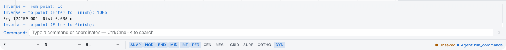

> **More COGO.** The **COGO** menu also has intersections (`ix`: where two lines meet when extended), radiations from a station (`rad`), traverse adjustment, resections, curve solutions and figure closures. Each works the same way: start the tool, then answer the prompts on the command line.

# The ground surface

A **surface** (a triangulated irregular network, or TIN) models the ground from your spot heights. Contours, volumes and sections all come from it.

1. Choose **Surface → Create surface** (or type `surface`).
2. **Name**: `Existing ground`.
3. Under **Points (with heights)**, choose the codes that are on the ground: `NS`, `PEG`, `TB`, `BB`, `KB`, `EP`, `TR` and `FNC`. Leave out `BLD`: the house corners are at floor level, not on the ground.
4. Under **Breaklines**, choose the codes `TB`, `BB`, `KB` and `EP`. Breaklines stop the surface triangles from cutting across a sharp change of grade, such as the top and bottom of the bank or a kerb.
5. Under **Limits**, click **Select one closed polyline**, then click the red lot boundary. The surface is clipped to the lot.
6. Under **Contours**, tick **Show**, set **Interval** to `0.25`, and tick **Label major contours**.
7. Tick **Colour by height** and **Shaded**, then click **Create**.

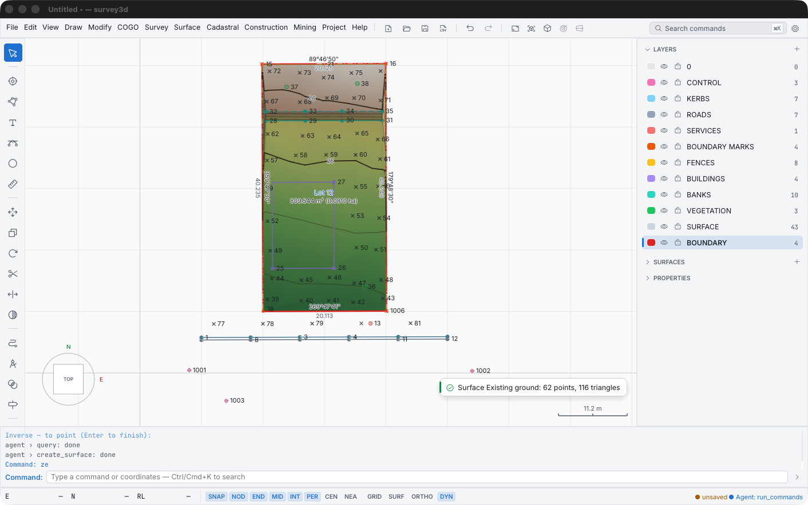

To see it in 3D, choose **View → Isometric view** (`iso`) and orbit with the right mouse button. Choose **View → Plan view** (`plan`) to go back.

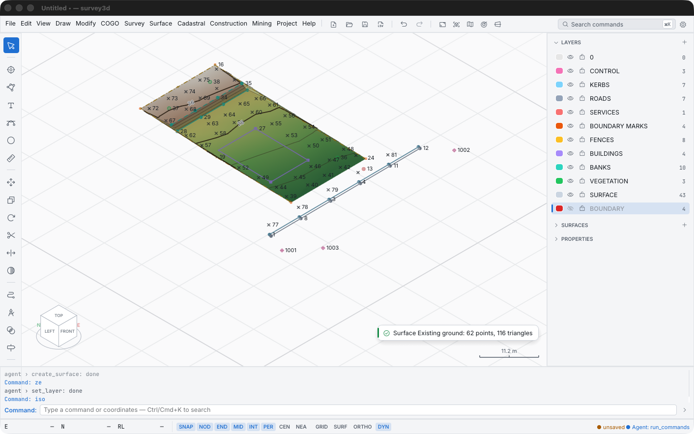

> **Breaklines matter.** Try creating a second surface without the breaklines and compare the contours along the bank. Without breaklines, triangles can cut across the bank and give contours that don't match the ground.

To draw the contours as real polylines, for example to export to CAD, use **Surface → Contours of the active surface to polylines** (`contours`).

# Volumes

The client is thinking of levelling the lot to **RL 25.30**. How much cut and fill is that?

1. Select the red lot boundary. The volume is calculated inside it.
2. Choose **Surface → Volumes** (or type `volume`).
3. Set **Base** to **Surface**: *Existing ground*.
4. Set **Top** to **Level**: `25.30`.
5. **Boundary**: click **Use selected**.
6. Click **Compute**.

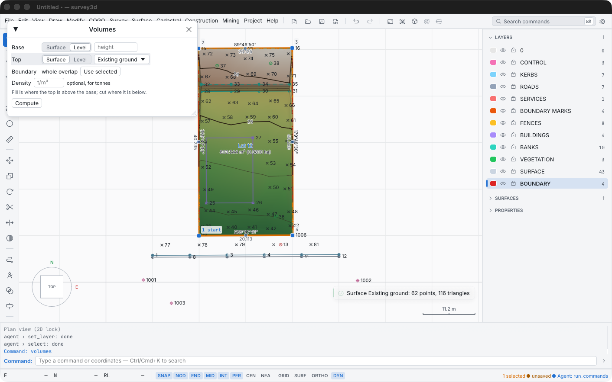

The report opens in the **Reports** window:

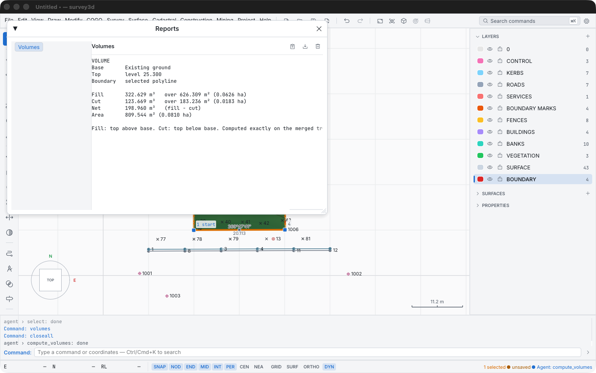

*Fill* is where the top (the level pad) is above the ground, and *cut* is where it is below. Levelling at RL 25.30 needs about 323 m³ of fill at the front and about 123 m³ of cut at the back, a net import of about 200 m³. That is useful for the client's earthworks quote.

> **Other volumes.** Base and top can both be surfaces, for example existing ground against a design surface, or before and after surveys of a stockpile. For stockpiles there is a dedicated tool: **Mining → Stockpile volume**.

# Setting out the shed

The client wants a 4 m × 3 m garden shed in the back yard. The designer has supplied its corner coordinates in `shed_design.csv`.

## Bring in the design points

1. Make a new layer called `DESIGN` (the **+** in the Layers panel). Design points should never be mixed with surveyed ones.
2. Import `tutorial/data/shed_design.csv` with **File → Import points**, columns **PENZCD**, and set **Layer** to **DESIGN**.

Points **S1** to **S4** appear in the back yard.

## The set-out sheet

You will set up the instrument on control mark **1001** and backsight **1002**. Instrument height is 1.55 m, and the prism pole is 1.80 m.

1. Select points S1 to S4 (click each one with **Shift** held, or drag a box around them).
2. Choose **Construction → Stake-out sheet** (or type `stakeout`).
3. **Instrument station**: `1001`. **Backsight**: `1002`. **Instrument / target height**: `1.55` and `1.80`.

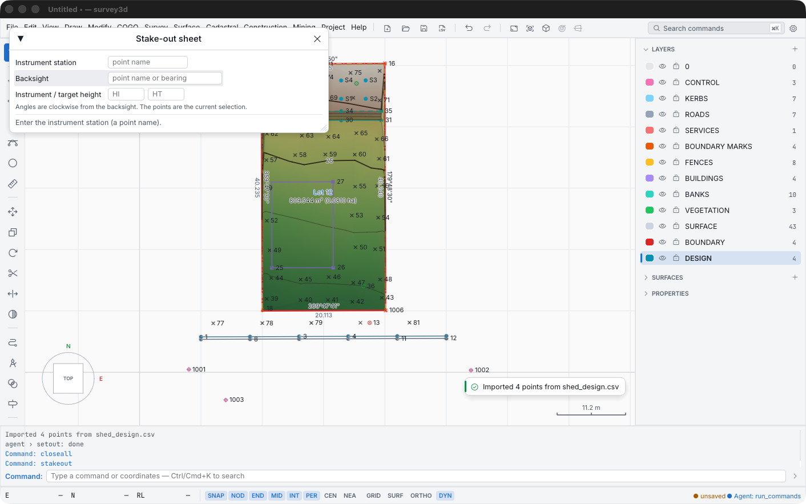

survey3d produces the set-out sheet: for each point, the horizontal angle to turn from the backsight, the bearing, the horizontal distance, the height difference, and the slope distance and zenith angle for your instrument and target heights. The **check distance** to the backsight (46.000 m) lets you confirm the setup before you start.

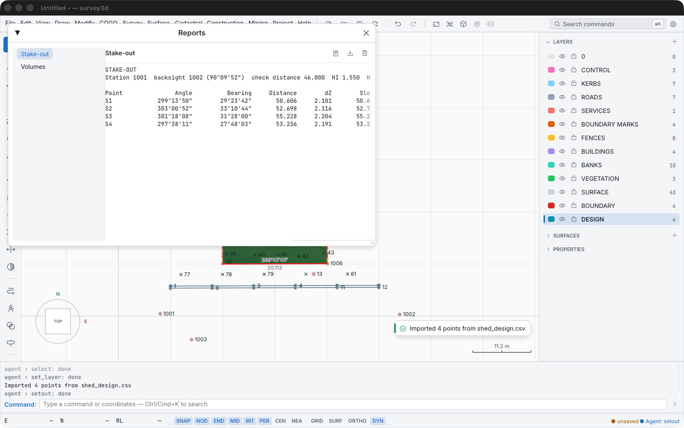

| Point | Angle from backsight | Distance | Description |
|-|---|--|---|
| S1 | 299°13'50" | 50.606 | Shed corner 1 |
| S2 | 303°00'52" | 52.698 | Shed corner 2 |
| S3 | 301°18'08" | 55.228 | Shed corner 3 |
| S4 | 297°38'11" | 53.236 | Shed corner 4 |

## Sending the points to the controller

Most crews would rather stake out from the controller than from a printed sheet:

1. With S1 to S4 still selected, choose **Construction → Export stake-out file** (`stakeexport`).
2. Pick the **Controller format**: Trimble JobXML, Carlson RW5, Leica GSI, or a plain CSV.
3. Click **Export…** and save the file.

Load the file onto the data collector and stake out by point name.

# The plan sheet

Now produce the detail survey plan.

1. Choose **File → Plan sheets** (or type `sheets`).
2. Click **New from view**. This creates a sheet framing what you can see.
3. Set **Paper** to **A3**, **Landscape**, **Scale** `1:250`.
4. Under **Position**, use **Centre on view** after panning the drawing where you want it, or type the centre coordinates.
5. Fill in the **Title block**:
    - **Title**: `Lot 12 Banksia Street`
    - **Subtitle**: `Detail and boundary survey`
    - **Surveyor**, **Reference** and **Date**.
6. Under **Show**, choose what goes on the sheet: linework, point symbols and labels, contours, parcels, grid, north arrow, scale bar and legend.

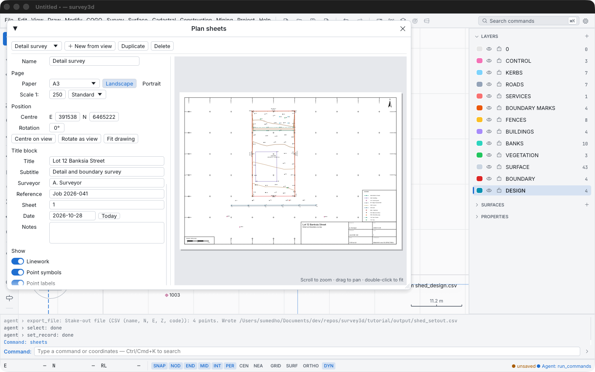

The preview on the right is exactly what will print. Scroll to zoom it, and drag to pan.

To print, choose **File → Export the current plan sheet to PDF** (`plotpdf`). The PDF is at true scale, so it measures correctly with a scale rule. Choose SVG instead if you want to finish the plan in a drawing program.

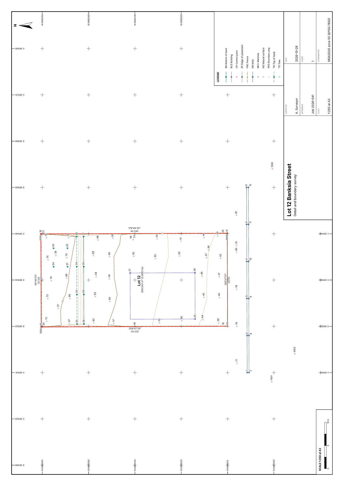{.fullpage}

# Saving, undo and the audit trail

## Save

Choose **File → Save project** (**Ctrl+S** / **⌘S**) and save the job as `lot12.s3d`. A survey3d project is a single file holding everything: points, lines, surfaces, parcels, sheets, feature codes, settings and the audit trail.

## Undo and redo

Every change is one step you can undo with **Edit → Undo** (**Ctrl+Z** / **⌘Z**) and redo with **Edit → Redo**. That includes importing a whole file, processing linework, or creating a surface. The **Edit** menu shows what the next undo will do.

## The audit trail

Choose **Project → Audit trail** (`audit`). Every change is recorded with the time (UTC), who made it and what changed. The records are chained together, so a later alteration to the history is detected: click **Verify integrity** to check the chain. The audit trail is what lets you stand behind a survey months later.

In the screenshot below, each change is recorded as *(agent via MCP)*, because the screenshots were taken by driving survey3d automatically. When you work through the tutorial yourself, your own user name appears (set it in **Settings → General → User name**).

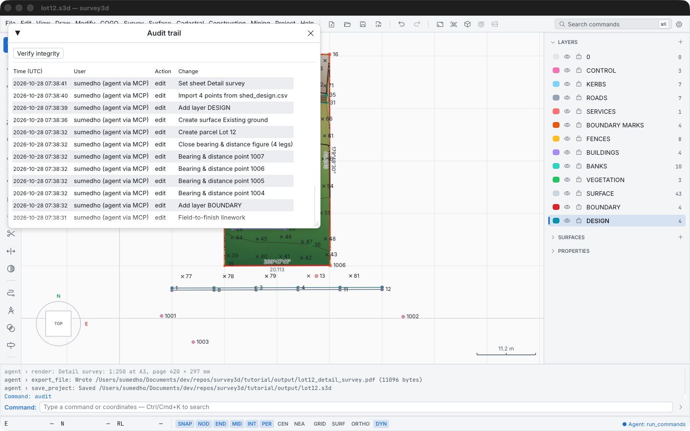

# What next?

You have taken a job from raw field data to a finished plan, volumes and a set-out. From here, explore:

- **Raw total-station data.** **File → Import raw data** reads Leica GSI, Trimble JobXML and Carlson RW5 files. **Survey → Reduce raw data** then turns the observations into coded points, with checks to known points.
- **Traverses and networks.** **COGO → Traverse** reduces and adjusts traverses (Bowditch or transit). **Survey → Least-squares network adjustment** adjusts whole networks, with error ellipses and blunder detection.
- **Site calibration.** **Survey → Site calibration** fits GNSS observations to local control.
- **Alignments.** **Construction → Alignments**: road and kerb alignments with chainages, curves and offsets.
- **Point clouds and imagery.** **File → Import point cloud** reads LAS/LAZ (very large clouds via COPC), and **File → Images** adds georeferenced orthophotos under the drawing.
- **Exports.** DXF for CAD, LandXML for surfaces and parcels, GeoPackage for GIS.

Type `help` on the command line at any time for the full list of tools and commands, and use **Ctrl+K** (**⌘K**) to search for anything.
